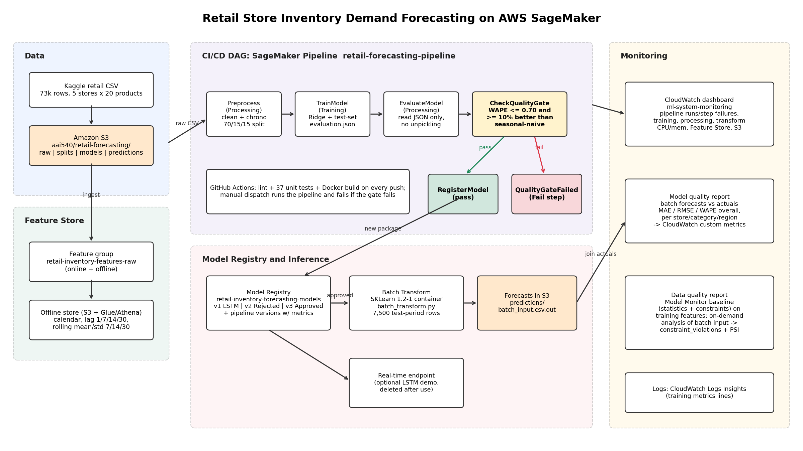

# Operations runbook: SageMaker Pipeline, registry, monitoring

How to run each operational component in SageMaker Studio (`us-east-1`) and where to inspect the result.
Run everything from the repo root in a Studio terminal. Studio supplies the
execution role, so no AWS keys are required.



| Component | Where to show it | Produced by |
|---|---|---|
| Feature store / feature groups | SageMaker console > Feature Store > `retail-inventory-features-raw` | `python -m src.aws.sagemaker.feature_store` (already created) |
| CI/CD DAG, success | Studio > Pipelines > `retail-forecasting-pipeline` > execution `gate-pass` | step 1 |
| CI/CD DAG, failure | same pipeline, execution `gate-fail` (red `QualityGateFailed`) | step 1 |
| Model registry | Studio > Models > Registered models > `retail-inventory-forecasting-models` | pipeline `RegisterModel` step + manual approval (step 2) |
| Batch inference output | S3 `predictions/batch_input.csv.out`, Batch transform job page | `python -m src.aws.sagemaker.batch_inference` |
| Model monitoring report | `reports/monitoring/model_quality.md` + `.png`, CloudWatch custom metrics | step 3 |
| Data monitoring report | `reports/monitoring/data_quality.md`, S3 `monitoring/data-quality/analysis/<run>/constraint_violations.json` | step 4 |
| Infrastructure dashboard | CloudWatch > Dashboards > `ml-system-monitoring` | step 5 |

## 0. Setup

```bash
git fetch origin && git checkout ved-development-2 && git pull
pip install -r requirements.txt
export SAGEMAKER_SUPPRESS_V2_WARNING=1
```

## 1. CI/CD DAG: one passing and one failing run (about 10 min each)

```bash
python -m src.aws.sagemaker.pipeline run --display-name gate-pass --wait
python -m src.aws.sagemaker.pipeline run --display-name gate-fail --max-wape 0.50 --wait
python -m src.aws.sagemaker.pipeline status
```

The DAG is `Preprocess > TrainModel > EvaluateModel > CheckQualityGate > RegisterModel | QualityGateFailed`.
The gate needs test WAPE <= `MaxTestWAPE` (default 0.70) **and** at least
`MinWAPEImprovement` (default 10%) lower WAPE than the seasonal-naive
baseline. Ridge scores about 0.64 test WAPE vs 0.87 for seasonal-naive
(26% better), so the default run passes; `--max-wape 0.50` fails it on purpose.
The pipeline uploads `data/raw/retail_store_inventory.csv` to S3 if it is not there yet.

The same pipeline can be started from GitHub: Actions > *MLOps CI/CD Pipeline* >
*Run workflow* (needs repository secrets `AWS_ACCESS_KEY_ID`,
`AWS_SECRET_ACCESS_KEY`, `AWS_SESSION_TOKEN`, `AWS_ROLE_ARN`). The
`sagemaker-pipeline` job fails when the gate fails, so the Actions graph
shows the failure too.

## 2. Model registry

Pipeline-registered packages are `PendingManualApproval` and carry
`evaluation.json` as model metrics. Approve one after checking it:

```bash
aws sagemaker list-model-packages --model-package-group-name retail-inventory-forecasting-models \
  --query 'ModelPackageSummaryList[].[ModelPackageVersion,ModelApprovalStatus]' --output table
aws sagemaker update-model-package --model-approval-status Approved \
  --model-package-arn arn:aws:sagemaker:us-east-1:<account>:model-package/retail-inventory-forecasting-models/<version>
```

## 3. Model-quality report (batch forecasts vs actuals)

Needs a completed batch transform (`predictions/batch_input.csv.out`) built
from the same `data/processed/test.parquet`.

```bash
python -m src.aws.sagemaker.monitoring_reports model-quality
```

Writes `reports/monitoring/model_quality.{md,json,png}`, uploads them to
`s3://<bucket>/aai540/retail-forecasting/monitoring/model-quality/<run>/`, and
publishes MAE/RMSE/WAPE (overall, seasonal-naive, per store) to CloudWatch
namespace `RetailForecasting/ModelQuality`.

## 4. Data-quality report (SageMaker Model Monitor, about 10 min)

```bash
python -m src.aws.sagemaker.monitoring_reports data-quality
```

Runs a Model Monitor `suggest_baseline` job on the engineered training
features, then an on-demand Model Monitor analysis job of the batch-inference
input against that baseline. Outputs `statistics.json`, `constraints.json`,
`constraint_violations.json` and `reports/monitoring/data_quality.md` (with a
PSI drift table). Expect the calendar features (`month`, `week_of_year`,
`quarter`) to drift because the test period is Sep-Dec while training starts
in January; lag/rolling demand features stay stable.

## 5. Infrastructure dashboard

```bash
python -m src.aws.sagemaker.infrastructure_monitoring
```

Creates `ml-system-monitoring`: pipeline executions and failed steps,
CPU/memory for training, processing (incl. Model Monitor) and batch-transform
jobs, Feature Store calls, S3 bucket size, model-quality metrics, the
endpoint (if deployed), and a Logs Insights table of the training jobs'
validation/test metrics. Set the time range to cover the runs above.

## Cost hygiene

Pipelines, processing, training and transform jobs stop by themselves. If you
  deploy the optional real-time endpoint, delete it after use.
